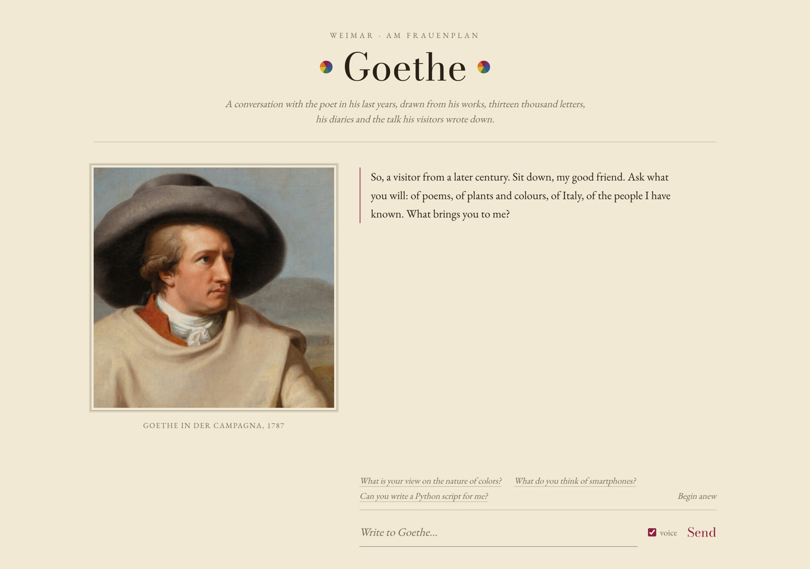
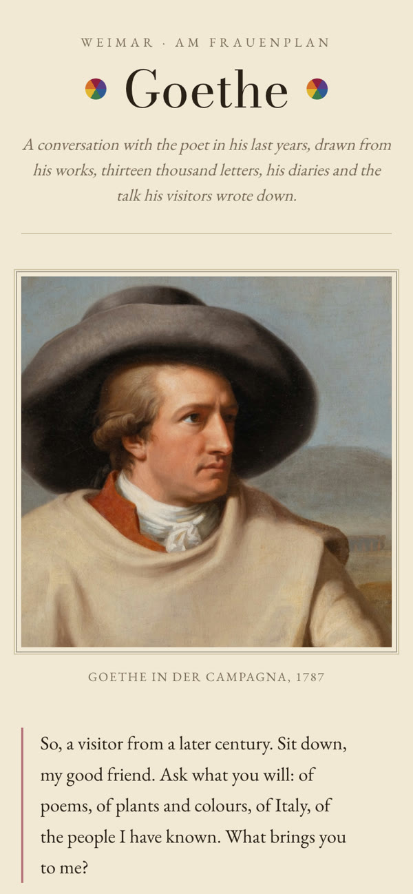

<div align="center">

# Goethe AI

**Talk to Johann Wolfgang von Goethe — grounded in 310 texts by and about him, voiced by AI, and painted by Tischbein.**




</div>

A full-stack, retrieval-augmented conversational persona of Goethe, built from his works, letters,
diaries and recorded conversations, plus what biographers and critics wrote *about* him. English
where a translation exists, German original otherwise. He answers in character: he quotes his own
writing, recalls what he once said aloud, and reacts to biographies of himself as a real person
would. While he speaks, his face in Tischbein's *Goethe in der Campagna* moves with his AI voice.

## Highlights

- **Agentic RAG**: Goethe decides himself whether to consult his papers, and writes his own
  search queries, in German, over ~110,000 chunks.
- **Three kinds of source**: his own words, conversations others wrote down, and biographies are
  labelled separately, and he treats each one differently.
- **A talking painting**: the 1787 canvas is warped live from the loudness of the speech. The jaw
  opens, the brows lift and he blinks. No video model and no GPU.
- **Memory**: he remembers the last 20 exchanges, and the browser keeps the conversation.

<table>
  <tr>
    <td align="center"></td>
    <td align="center"></td>
  </tr>
  <tr>
    <td align="center"><sub>The painted face, animated by <code>frontend/lib/face.ts</code></sub></td>
    <td align="center"><sub>On a phone</sub></td>
  </tr>
</table>

<details>
<summary>Full source list (310 texts, ~110,000 chunks)</summary>

**His own works, in English translation:**
Faust, Part I · The Sorrows of Young Werther · Theory of Colours · The Poems of Goethe ·
The Autobiography of Goethe (Poetry and Truth) · Maxims and Reflections ·
Wilhelm Meister's Apprenticeship (Vols. I–II) · Letters from Switzerland and Travels in Italy ·
Egmont · Hermann and Dorothea · Erotica Romana · Iphigenia in Tauris ·
Goethe's Literary Essays · Goethe and Schiller's Xenions · The Princess and the Tiger

**His own writings, German original (TextGrid Repository, see below):**
**Werke** — the collected works: *Faust* I and II, the *Urfaust*, the complete poems, the plays,
novels and tales, *Dichtung und Wahrheit*, *Italienische Reise*, *Tag- und Jahreshefte*, *Maximen
und Reflexionen*, some 45 essays on art and literature · **Science** — *Zur Farbenlehre*
(didactic, polemical and historical parts), the morphology and geology essays, and two volumes of
papers and drafts on osteology, optics and physics · **Briefe** — 13,000 letters 1764–1832, one
file per year, each headed with year and addressee · **Tagebücher** — the diaries 1775–1832 ·
**Gespräche** — Biedermann's edition of his recorded conversations (Eckermann, Kanzler von
Müller, Riemer, Soret and hundreds of visitors), each headed with date and partner · plus *Die
Geschwister* from Gutenberg

**Biographies and essays about him (by other authors):**
*Life of Johann Wolfgang Goethe* (James Sime) · *The Youth of Goethe* (P. Hume Brown) ·
*Representative Men* (Emerson, incl. his essay on Goethe) · *Three Philosophical Poets*
(Santayana, incl. chapter on Goethe) · *Three Essays* (Thomas Mann, incl. "Goethe and Tolstoy") ·
*Biographical Essays* (De Quincey, incl. essay on Goethe) · *Man or Matter* (Ernst Lehrs, on
Goethe's scientific worldview) · *The Three Devils* (David Masson, incl. essay on Goethe's
Mephistopheles) · *The Faust-Legend and Goethe's 'Faust'* (H. B. Cotterill) · *Kant und Goethe*
(Georg Simmel, German) · *Aus Goethes Frühzeit* (Wilhelm Scherer, German) · *J. W. v. Goethe's
Biographie* (Heinrich Döring, German) · *Goethes Lebenskunst* (Wilhelm Bode, German)

Each chunk is tagged `primary` (Goethe's own words), `conversation` (his talk as written down by
someone who was in the room) or `biography` (someone else's account of him) in the vector store's
metadata, and the persona prompt treats the three differently — quoting his own works directly,
recalling conversations as things he once said aloud, and reacting to biographical passages as a
real person hearing what history says about him ("I am told...").

Deliberately excluded: near-duplicate re-translations of works already covered (e.g. three other
English Faust Part I translations), anthologies where Goethe is a minor contributor among other
authors, and fictionalized "historical romance" novels about him rather than factual biography.
</details>

Built end-to-end from [`Goethe_AI_Agenda.md`](./Goethe_AI_Agenda.md).

## How it works

```
frontend (Next.js) --/api/chat--> backend (FastAPI) --> agent loop (gpt-4o-mini as Goethe)
                                                          |  ^
                                    search_papers(query,  |  |  passages, labelled as his own
                                    kind) — up to 3 rounds v  |  writing / conversation / biography
                                                        ChromaDB (local vector store)
       <------------- reply + sources -------------
       |
       +--/api/tts--> OpenAI TTS (tts-1) --> mp3 --> <audio> --> AnalyserNode drives the painted face
```

- **Data pipeline** (`backend/scripts/`): downloads (Gutenberg by hand, TextGrid via
  `fetch_textgrid.py`) → cleans Gutenberg boilerplate/footnotes →
  recursively chunks (~700 chars, 100 char overlap) → embeds with `text-embedding-3-small` →
  stores in a local persistent ChromaDB collection.
- **Agent** (`backend/app/agent.py`): one agent, one tool. Goethe himself decides whether to
  consult his papers and writes the search queries (in German, since most of the corpus is),
  optionally restricted to his own writing, his recorded conversations or the biographies. He may
  search up to three rounds, then must answer. Small talk costs no search at all.
- **Memory**: he sees the last 20 exchanges (`MEMORY_TURNS`); the browser keeps the conversation
  in `localStorage` until "Begin anew".
- **Talking portrait** (`frontend/components/TalkingPortrait.tsx`, `frontend/lib/face.ts`):
  Tischbein's *Goethe in der Campagna* (1787, Städel Museum, public domain), drawn on a canvas.
  The loudness of the TTS audio (`AnalyserNode`) opens his jaw and lifts his brows by warping the
  painting itself, column by column; he blinks now and then. No video model, no GPU.

## Getting started

You need Python 3, Node.js and an OpenAI API key. The source texts are in the repository, so
nothing else has to be downloaded.

### 1. Backend

```bash
cd backend
python3 -m venv .venv && source .venv/bin/activate
pip install -r requirements.txt
cp .env.example .env              # then set OPENAI_API_KEY

python scripts/clean.py           # strip Gutenberg boilerplate     → data/processed/*.txt
python scripts/chunk.py           # ~700-character chunks          → data/processed/chunks.jsonl
python scripts/ingest.py          # embed into ChromaDB, ~$0.50     → chroma_db/

uvicorn app.main:app --reload --port 8000
```

The three scripts only need to run once. Afterwards, `http://localhost:8000/api/health` should
report `vectors_indexed` above zero.

### 2. Frontend

```bash
cd frontend
npm install
cp .env.local.example .env.local
npm run dev
```

Then open `http://localhost:3000`.

### Configuration

| Variable | Where | Default | Purpose |
| --- | --- | --- | --- |
| `OPENAI_API_KEY` | `backend/.env` | none | Chat, embeddings and speech |
| `GOETHE_CHAT_MODEL` | `backend/.env` | `gpt-4o-mini` | The model that plays Goethe |
| `GOETHE_TTS_VOICE` | `backend/.env` | `onyx` | OpenAI voice for his speech |
| `CORS_ORIGINS` | `backend/.env` | `http://localhost:3000` | Allowed frontend origins, comma-separated |
| `NEXT_PUBLIC_API_BASE` | `frontend/.env.local` | `http://localhost:8000` | Where the frontend finds the backend |

## Project layout

```
backend/
  app/
    main.py              FastAPI: /api/chat, /api/tts, /api/health
    agent.py             the search-then-answer loop
    persona.py           Goethe's system prompt
    rag.py               retrieval from ChromaDB
    config.py            models and settings
  scripts/
    fetch_textgrid.py    download and flatten the TextGrid corpora
    clean.py             strip Gutenberg headers, footers and footnotes
    chunk.py             split the texts into overlapping chunks
    ingest.py            embed the chunks and load them into ChromaDB
  data/raw/              source texts
  data/processed/        cleaned texts and chunks.jsonl (generated)
  chroma_db/             vector store (generated)
frontend/
  app/                   Next.js page and layout
  components/
    ChatPanel.tsx        the conversation
    TalkingPortrait.tsx  the painting, the audio and the animation loop
  lib/
    api.ts               calls to the backend
    face.ts              facial features of the painting and the warp
docs/                    screenshots for this README
```

## Working with the corpus

**Adding texts.** Put a `.txt` file into `backend/data/raw/` and run `clean.py`, `chunk.py` and
`ingest.py` again, in that order. `ingest.py` rebuilds the collection from scratch, so this is
always safe.

**Refreshing the TextGrid corpora.** The German works, letters, diaries and conversations come
from the [TextGrid Repository](https://textgridrep.org). To download them again:

```bash
python scripts/fetch_textgrid.py
```

It fetches seven TEI corpora into `data/tei_cache/` (about 500 MB; the letters alone take over 20
minutes) and writes plain text plus `textgrid_sources.json` into `data/raw/`. Lines starting with
`@@ ` are section headings, which `chunk.py` puts in front of each chunk, for example
`[1823, 10. Juni. Mit Johann Peter Eckermann]`.

## Evaluation

Three test prompts cover the persona's main behaviours. They are also the suggestion buttons in
the chat.

| Prompt | Tests | Expected |
| --- | --- | --- |
| "What is your view on the nature of colors?" | Knowledge from the corpus | Draws on *Theory of Colours* and argues against Newton |
| "What do you think of smartphones?" | Questions beyond his time | A wry deflection, in character |
| "Can you write a Python script for me?" | Requests outside the role | A poetic refusal, in character |

## Responsible use

There are no recordings of Goethe, who died in 1832, so no voice or face model could be trained on
him, and building one would not be appropriate anyway. The voice is a stock synthetic voice, and
the animation only warps a public-domain painting. The project is meant for demonstration and
portfolio use. The footer in the UI states that it is an AI persona, not a record of Goethe's
actual views.

## Credits

- Texts: [TextGrid Repository](https://textgridrep.org) (CC BY 3.0 DE) and
  [Project Gutenberg](https://www.gutenberg.org) (public domain).
- Painting: Johann Heinrich Wilhelm Tischbein, *Goethe in der Campagna*, 1787, Städel Museum,
  Frankfurt am Main (public domain, via
  [Wikimedia Commons](https://commons.wikimedia.org/wiki/File:Goethe_in_the_Roman_Campagna_(SM_1157).png)).
